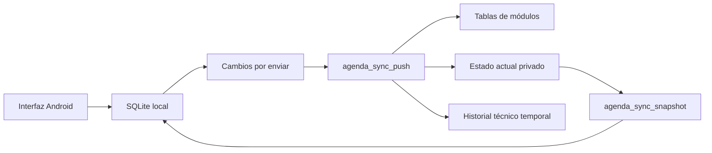

# Arquitectura

## Android

La aplicación usa actividades Android, vistas XML y Java. `RegistroActivity` centraliza los listados, filtros, detalles y formularios de módulos; `Definicion`, `Campo` y `Fuentes` describen campos y adaptan los repositorios tipados. `MainActivity` y `AgendaActivity` tienen presentaciones propias.

`DatabaseHelper` crea y migra SQLite. Los repositorios registran la modificación y su cambio de sincronización dentro de la operación local. Los identificadores son UUID; cada entidad tiene propietario, revisión y marcas de creación, actualización y baja.

## Sincronización

- `CoordinadorSync`: ejecutor único, renovación de sesión, observadores de estado, reintentos y programación de trabajo.
- `TrabajoSync`: trabajo Android sujeto a disponibilidad de red y a la opción de sincronización automática. El período solicitado es 15 minutos; Android decide la ejecución efectiva.
- `MotorSync`: envío por lotes, recepción paginada, reintento de dependencias y confirmaciones. Permite pruebas con transporte y almacenamiento controlados.
- `SupabaseRest`: HTTPS y funciones RPC, sin SDK Supabase adicional ni claves administrativas.
- `AlmacenSync`: salida, recibos, entradas diferidas, conflictos, bases remotas y contadores durables.
- `ReglasSync`, `ReglasEstadoSync` y `JsonSync`: revisiones, comparación de versiones y autorización de reemplazo de una copia local sin cambios.

El protocolo 2 no necesita reproducir el historial entero para recibir un registro. Cada ciclo consulta el estado actual por páginas. Esto prioriza la recuperación robusta de una agenda personal; todavía no hay un protocolo de descarga incremental por cursor de servidor.

La base remota y la local conservan las bajas lógicas. Ante ramas divergentes se preservan versiones y se solicita una decisión manual. La actualización de una copia local desde un snapshot depende de que siga coincidiendo con su base remota conocida.

## Recurrencias

`ReglaRecurrencia` calcula fechas sin depender de Android. `SeriesEvento` conserva reglas y segmentos en `series_eventos.configuracion_personalizada`, y usa `eventos_ocurrencias` para las excepciones materializadas. Las ocurrencias sin modificaciones se calculan y tienen UUID estable por serie y ordinal.

La recurrencia viaja con sus metadatos de sincronización. El calendario conserva el día preferido de mes o año, ajustando los meses cortos sin perder ese día para futuras ocurrencias.

## Inicio y temas

`ProgresoDia` y `ResumenDia` calculan el resumen de hoy con fechas funcionales. El selector del radar corresponde a `ProgresoInicio` y no cambia la cara ni el porcentaje diario. El gráfico lineal no se presenta en Inicio.

`Tema` y `ActividadTematica` aplican la elección de apariencia. Los colores se resuelven por atributos para separar fondos, botones, módulos, frases y estados. Los paisajes están en recursos de la app y son decorativos: no contienen indicadores ni datos de usuario dibujados.

## Avisos

`ProgramadorAvisos` recalcula recordatorios desde SQLite y ocurrencias virtuales. `ReceptorAvisos` atiende alarmas y eventos del dispositivo. `VentanaAvisos` implementa la superposición opcional con iconos de categoría y una lista desplegable.

Los permisos de notificaciones, alarmas exactas y superposición son independientes. Finalizar, cancelar o postergar un registro deja de considerarlo activo para sus avisos. El sistema vuelve a programar tras los eventos de reinicio o cambios de hora contemplados en el manifiesto.

## Sesión, cifrado y copias

`SesionSegura` protege tokens locales con Android Keystore y AES-GCM. La contraseña de autenticación no se conserva en el código ni en una configuración versionada. Los datos funcionales se intercambian en JSON por HTTPS: no existe cifrado de extremo a extremo de las entidades.

SQLite no usa SQLCipher. El respaldo completo exportado sí se cifra mediante AES-256-GCM con clave derivada por PBKDF2-HMAC-SHA256 y 210000 iteraciones. La restauración valida estructura e integridad y copia las filas en una transacción; conserva un estado previo interno y pausa la sesión de sincronización.

Las reglas de copia del sistema Android excluyen preferencias de sesión, identidad y estado de sincronización. El proyecto no garantiza que las bases funcionales queden excluidas de todos los mecanismos de copia del sistema. El respaldo propio de la app es un mecanismo separado.
