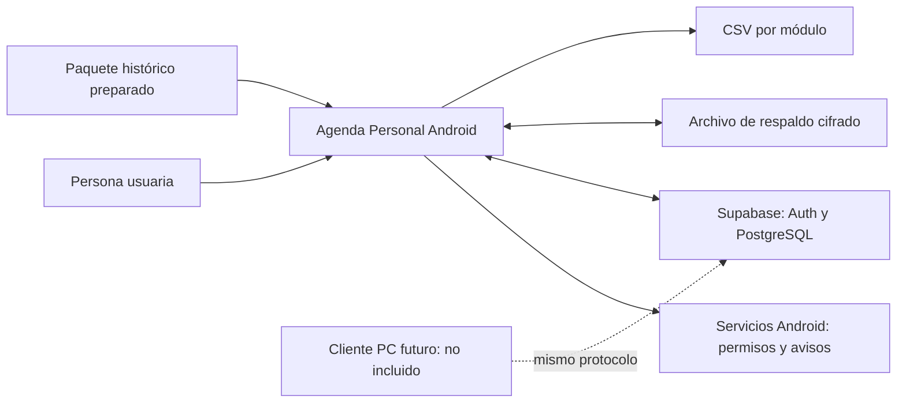
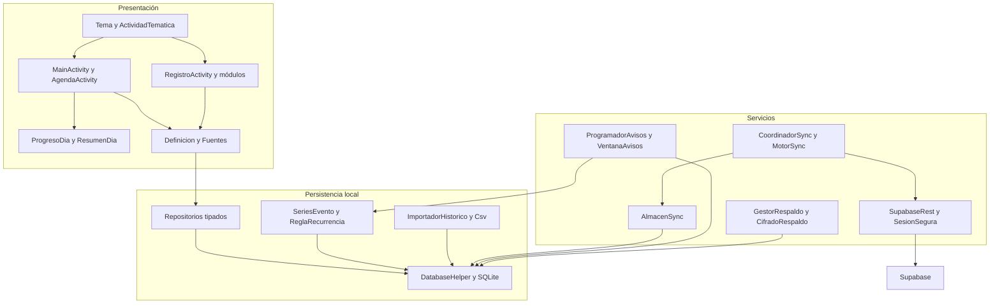
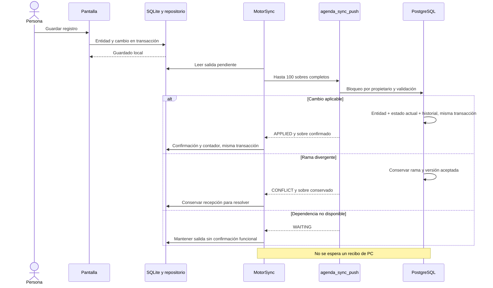
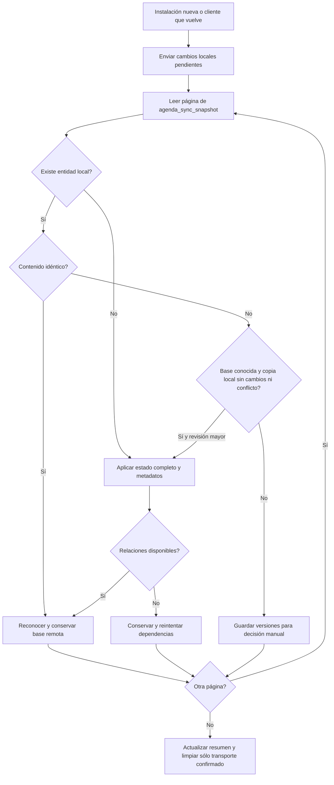
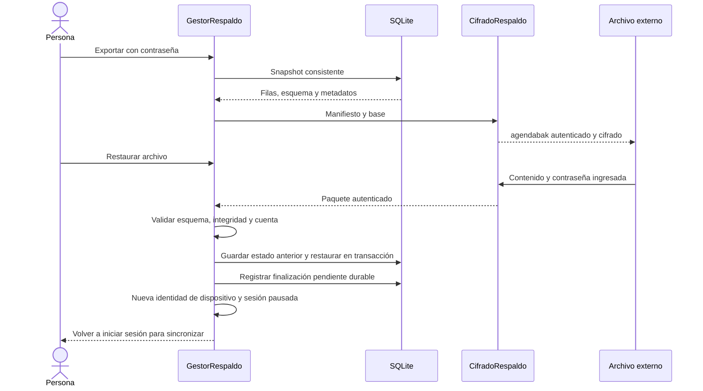
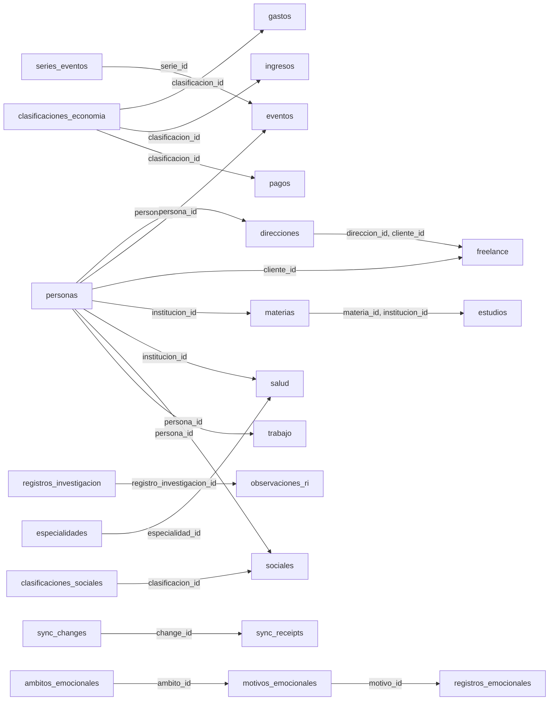

# Blueprints de arquitectura

Los diagramas se muestran en GitHub con Mermaid. Cada uno tiene una fuente `.mmd` editable en `docs/blueprints/`. Se corresponden con el código actual; no describen una plataforma multiusuario ni un cliente PC implementado.

## Contexto y límites

La aplicación entregada es Android. El cliente PC aparece como una extensión futura, no como software incluido.

[Fuente editable](blueprints/01_contexto.mmd)

## Componentes Android

Dependencias conceptuales entre presentación, reglas, persistencia y servicios. No es un diagrama exhaustivo de cada llamada.

[Fuente editable](blueprints/02_componentes.mmd)

## Escritura y confirmación remota

Un registro aceptado queda persistido sin esperar que se conecte otra instalación. Un conflicto conserva una rama, sin convertirla en la versión aceptada.

[Fuente editable](blueprints/03_envio.mmd)

## Recuperación y aplicación del estado

La recuperación usa revisiones actuales, base conocida y preservación de cambios locales. Las páginas pueden tener dependencias.

[Fuente editable](blueprints/04_recuperacion.mmd)

## Copia y restauración

El formato cifrado y la restauración transaccional son independientes de la sincronización.

[Fuente editable](blueprints/05_respaldo.mmd)

## Relaciones declaradas en SQLite

Generado desde las claves foráneas reales. Las flechas van de tabla referenciada a dependiente; no representan cardinalidad. Consultar nulabilidad y claves compuestas en el diccionario.

[Fuente editable](blueprints/06_relaciones_datos.mmd)

## Navegación técnica

- [Arquitectura y responsabilidades](ARQUITECTURA.md)
- [Protocolo y contratos RPC](PROTOCOLO_SYNC.md)
- [Diccionario de datos](DICCIONARIO_DATOS.md)
- [Árboles de archivos](ARBOLES_ARCHIVOS.md)
- [Inventario de código](INVENTARIO_CODIGO.md)
- [Decisiones técnicas](DECISIONES_TECNICAS.md)

Los diagramas 1 a 5 se mantienen como fuentes editables. El diagrama 6 y el DDL de referencia se regeneran con `python tools/documentacion/generar_referencias.py`. Después de cambiar la arquitectura o el esquema, actualizar tanto el diagrama fuente como su bloque de visualización.
